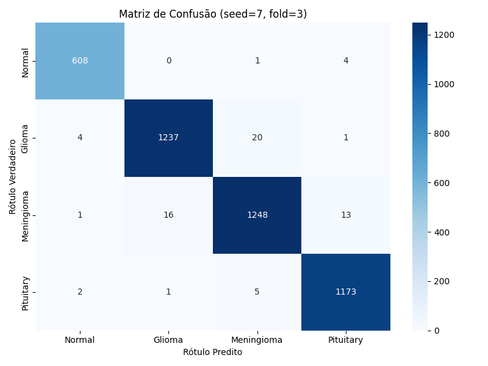
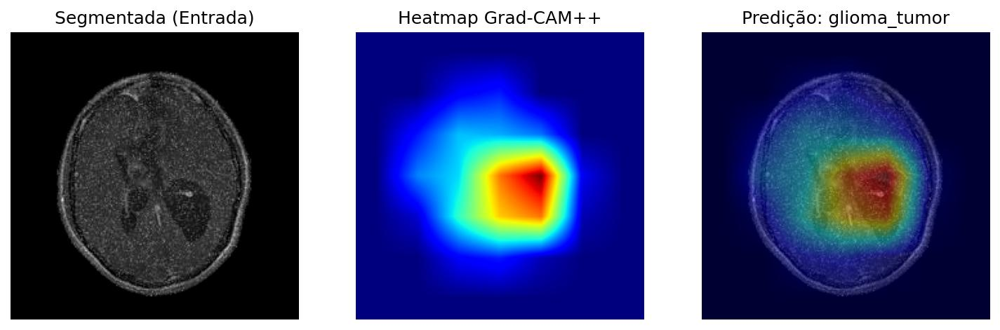
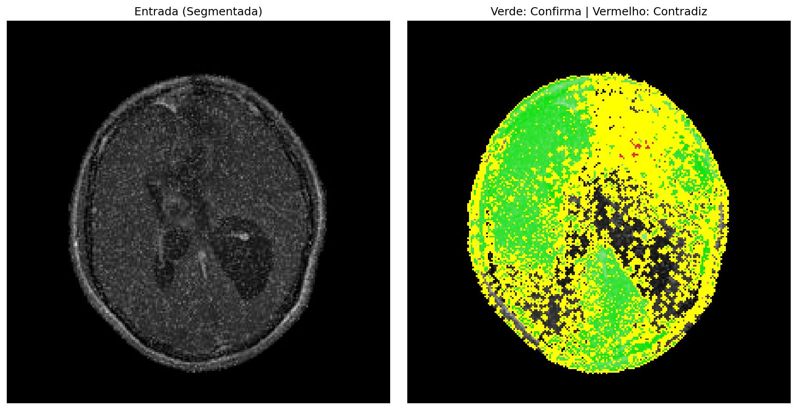
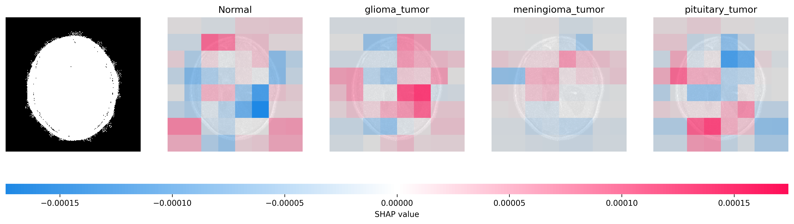

# Classificação de Tumores Cerebrais com EfficientNetB0 + Explicabilidade (XAI)

Projeto de classificação de imagens de ressonância magnética (MRI) em 4 classes
(`Normal`, `glioma_tumor`, `meningioma_tumor`, `pituitary_tumor`), usando
**transfer learning com EfficientNetB0**, com foco em duas frentes:

1. **Robustez do treino** — validação cruzada estratificada (k-fold) repetida com
   múltiplas seeds, para medir a variabilidade das métricas do modelo
   (média ± desvio padrão).
2. **Explicabilidade (XAI)** — geração e avaliação quantitativa de explicações
   visuais das predições com **Grad-CAM++**, **LIME** e **SHAP**.

## Estrutura do repositório

| Notebook | Descrição |
|---|---|
| `_VERSAO_8__Modelo_Desvio_Hiperparametro.ipynb` | Pipeline completo de treino: pré-processamento/segmentação das imagens, busca de hiperparâmetros (Keras Tuner / Hyperband), validação cruzada estratificada em múltiplas seeds (transfer learning + fine-tuning) e avaliação (accuracy, precision, recall, F1, matriz de confusão). |
| `_VERSAO_4__Modulos_Explicabilidade_com_Gini_AOPC.ipynb` | Módulos independentes de explicabilidade (Grad-CAM++, LIME, SHAP) aplicados ao melhor modelo treinado (seed + fold), com avaliação quantitativa das explicações via **Índice de Gini** e **AOPC**. |

## Pipeline

### 1. Pré-processamento e segmentação
As imagens de MRI passam por uma segmentação com OpenCV (Otsu + maior
componente conectado + convex hull) para isolar a região do cérebro antes do
treino, reduzindo ruído de fundo. O convex hull evita que um tumor com brilho
parecido com o fundo vire um "buraco" na máscara. A segmentação é feita uma
única vez e salva em disco local, evitando gargalo de CPU durante o treino em GPU.

### 2. Modelo
- **Arquitetura base:** EfficientNetB0 pré-treinada na ImageNet (transfer learning), com cabeça de classificação customizada (GlobalAveragePooling + BatchNormalization + Dropout + Dense + Dropout, com regularização L2).
- **Busca de hiperparâmetros:** Keras Tuner (Hyperband), otimizando a cabeça do modelo (dropout, unidades da camada densa, regularização L2, learning rate). A busca usa uma fração de 25% dos dados (split fixo 80/10/10) e poucas épocas para economizar processamento; o resultado é salvo em `melhores_hiperparametros.json` e reaproveitado no treino.
- **Treino em duas fases:** (1) transfer learning com a base congelada e (2) fine-tuning com a base descongelada e learning rate reduzido (`1e-5`), com `EarlyStopping`, `ReduceLROnPlateau` e `ModelCheckpoint`.
- **Tamanho de imagem:** 224x224.

### 3. Avaliação de robustez (validação cruzada com múltiplas seeds)
O treino completo (fases 1 e 2) é executado com **validação cruzada estratificada
de 5 folds**, repetida para **5 seeds diferentes** (`42, 123, 2024, 7, 55`),
totalizando **25 execuções** (5 seeds × 5 folds). A seed controla tanto o
embaralhamento que define os folds quanto a inicialização do modelo.

Em cada execução, 1 fold é o conjunto de **teste** e os outros 4 formam
treino + validação (12,5% do restante, equivalente a 10% do total). Dessa forma,
cada imagem é testada exatamente uma vez por seed. Os resultados são salvos
incrementalmente em JSON, e cada execução também salva seu modelo (`.keras`) e o
gráfico de loss/accuracy (com marcação do início do fine-tuning).

Ao final, calcula-se média e desvio padrão amostral (ddof=1) sobre as 25 execuções de:
- Loss
- Accuracy
- Precision
- Recall
- F1-score

O modelo com melhor F1 entre as execuções (par seed + fold) é usado para gerar
a matriz de confusão final, sobre o conjunto de teste do seu respectivo fold, e
como modelo de referência nos módulos de explicabilidade.

### 4. Explicabilidade (XAI)
Aplicada sobre o melhor modelo treinado (ou sobre uma execução escolhida
manualmente via `SEED_ESCOLHIDA` / `FOLD_ESCOLHIDO`), por classe:

- **Grad-CAM++** — mapas de calor das regiões que mais influenciaram a predição.
- **LIME** — explicação por perturbação de superpixels (com 3 modos de visualização: comparativo, prós/contras e isolamento).
- **SHAP** — atribuição pixel a pixel via `shap.Explainer` (masker de imagem, abordagem black-box).

As imagens explicadas são sorteadas **somente entre as imagens de teste do fold**
do modelo carregado (5 por classe, por padrão), ou seja, imagens que o modelo
nunca viu no treino/validação, evitando vazamento de dados. O pré-processamento
reproduz exatamente o do treino.

### 5. Avaliação quantitativa das explicações
Cada técnica de XAI é avaliada com duas métricas, por imagem e por classe:

- **Índice de Gini** — mede o quão *concentrada* está a importância atribuída pela explicação (0 = espalhada por toda a imagem, 1 = concentrada em poucos pixels/regiões).
- **AOPC (Area Over the Perturbation Curve)** — mede o quanto a probabilidade da classe predita cai ao remover progressivamente as regiões apontadas como mais importantes. Quanto **maior**, mais a explicação de fato aponta para regiões relevantes para a decisão do modelo.

Os resultados são salvos incrementalmente, **separados por modelo** (seed/fold),
e consolidados em um relatório (médias e desvios por técnica e por classe),
exportado também como CSV.

## Como executar

Os notebooks foram desenvolvidos para rodar no **Google Colab**, com o dataset
([`mohammadhossein77/brain-tumors-dataset`](https://www.kaggle.com/datasets/mohammadhossein77/brain-tumors-dataset))
baixado via `kagglehub` e os artefatos (modelos, gráficos, métricas) salvos no
Google Drive.

1. Execute `_VERSAO_8__Modelo_Desvio_Hiperparametro.ipynb`:
   - Seção 1–2: configuração, download, segmentação do dataset e função que gera os folds.
   - Seção 3.1: busca de hiperparâmetros (executar uma vez; resultado fica salvo em `melhores_hiperparametros.json`).
   - Seção 5: validação cruzada (por padrão, uma execução da célula = uma combinação seed + fold; ajuste `EXECUCOES_POR_RODADA` para treinar mais de uma por rodada). São 25 execuções no total.
   - Seção 6–7: métricas consolidadas e matriz de confusão da melhor execução.
2. Execute `_VERSAO_4__Modulos_Explicabilidade_com_Gini_AOPC.ipynb`:
   - **Módulo 0** (sempre primeiro): carrega o melhor modelo treinado (seed + fold), monta o banco de imagens de teste e define as funções de Gini/AOPC.
   - **Módulos 1–3**: gere as explicações (Grad-CAM++, LIME, SHAP) e as respectivas avaliações (Gini/AOPC), classe a classe.
   - **Módulo 4**: relatório consolidado com médias, desvios e exportação em CSV.

### Dependências principais
`tensorflow` / `keras`, `keras-tuner`, `opencv-python`, `scikit-learn`,
`scikit-image`, `lime`, `shap`, `numpy`, `pandas`, `matplotlib`, `seaborn`,
`kagglehub`.

## Resultados

### Desempenho do modelo (média ± desvio padrão, 5 seeds × 5 folds = 25 execuções)

| Métrica | Média | Desvio Padrão |
|---|---|---|
| Accuracy | `93.92%` | `7.07%` |
| Precision | `94.72%` | `5.82%` |
| Recall | `93.06%` | `8.45%` |
| F1-score | `93.89%` | `7.12%` |
| Loss | `0.2836` | `0.2016` |

O desvio padrão elevado vem de uma distribuição bimodal: 18 das 25 execuções
atingiram ~98% de accuracy, enquanto 7 ficaram em ~83% (seed 123: folds 1, 2 e 4;
seed 2024: fold 0; seed 7: folds 0, 2 e 4). As execuções por seed e fold estão
em `resultados_cv/execucoes.json`.

| Métrica | Média (18 execuções que convergiram) | Desvio Padrão |
|---|---|---|
| Accuracy | `98.24%` | `0.27%` |
| Precision | `98.27%` | `0.26%` |
| Recall | `98.21%` | `0.28%` |
| F1-score | `98.23%` | `0.27%` |
| Loss | `0.1611` | `0.0212` |

### Matriz de confusão (melhor execução: seed 7, fold 3)



### Avaliação das explicações (Gini / AOPC)

Calculada sobre o melhor modelo (seed 7, fold 3), com 5 imagens de teste por classe
(20 imagens por técnica).

| Técnica | Gini (média ± dp) | AOPC (média ± dp) |
|---|---|---|
| Grad-CAM++ | `0.6507 ± 0.11` | `0.5798 ± 0.28` |
| LIME | `0.5726 ± 0.11` | `0.5792 ± 0.29` |
| SHAP | `0.5195 ± 0.08` | `0.5640 ± 0.30` |

### Exemplos visuais





## Estrutura de diretórios (Google Drive)

```
Projeto/Desv_Hip/
└── 224x224/
    ├── modelos_salvos_cv/      # modelos .keras por seed e fold
    ├── graficos_cv/            # curvas de loss/accuracy por seed e fold
    ├── tuner/                  # progresso do Keras Tuner (Hyperband)
    ├── resultados/             # melhores_hiperparametros.json
    ├── resultados_cv/          # execucoes.json, resumo_metricas.json, matriz de confusão,
    │                           # test_paths/test_labels de cada seed e fold
    └── explicabilidade_cv/
        └── seed{S}_fold{K}/    # uma pasta por modelo explicado
            ├── GradCAM/
            ├── LIME/
            ├── SHAP/
            └── metricas/       # gini/aopc por técnica e classe (JSON + CSV)
```

## Licença

`TODO`
